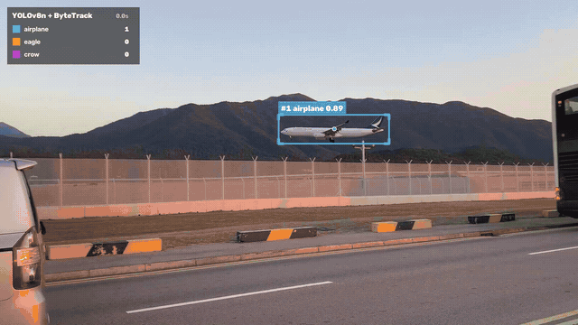

# YOLOv8 비행기 · 독수리 · 까마귀 감지 및 추적

인공지능 과목 YOLO 과제. YOLOv8n을 3개 부류(airplane, eagle, crow)에 대해 전이학습하고, 학습한 모델로 동영상에서 객체 감지 및 추적을 수행했다.



## 결과물

- 학습 모델: [models/sky3_yolov8n_best.pt](models/sky3_yolov8n_best.pt)
- 감지 + 추적 영상 (5초): [results/tracking_result.mp4](results/tracking_result.mp4)
- 객체별 궤적 좌표: [results/tracking_result_trajectory.csv](results/tracking_result_trajectory.csv)
- 학습 그래프, 혼동행렬: [results/train_plots/](results/train_plots/)

## 데이터 및 학습

- 데이터: Open Images V7, 부류당 250장 (train 600 / val 150)
- 모델: YOLOv8n (COCO 사전학습 가중치에서 전이학습)
- 설정: epoch 30, imgsz 480, batch 16, CPU 학습
- 추적: ByteTrack

| 부류 | Precision | Recall | mAP50 | mAP50-95 |
|---|---|---|---|---|
| 전체 | 0.887 | 0.795 | 0.871 | 0.649 |
| airplane | 0.894 | 0.664 | 0.768 | 0.547 |
| eagle | 0.866 | 0.918 | 0.937 | 0.745 |
| crow | 0.901 | 0.803 | 0.909 | 0.655 |

## 실행 방법

```bash
pip install ultralytics pandas imageio-ffmpeg lap
python scripts/01_build_dataset.py --meta <Open Images 라벨 CSV 폴더> --out datasets/sky3 --per-class 250
python scripts/02_train.py --data datasets/sky3/data.yaml --epochs 30 --imgsz 480
python scripts/03_make_input_video.py
python scripts/04_track.py --model models/sky3_yolov8n_best.pt --source videos/input_5s.mp4 --out results/tracking_result.mp4 --imgsz 576 --conf 0.35
```

## 출처

- 학습 이미지: [Open Images Dataset V7](https://storage.googleapis.com/openimages/web/index.html) (어노테이션 CC BY 4.0, 이미지 CC BY 2.0)
- 입력 영상 (Wikimedia Commons)
  - "Airplane Landing at South Runway, HKIA 20210215", IamCristYe, CC BY-SA 4.0
  - "Zittende en vliegende zeearenden van verschillende leeftijden", Marc Plomp, CC BY-SA 3.0 NL
  - "Jungle crow (Corvus macrorhynchos) in a park", The Nature Box, CC BY 4.0
- [Ultralytics YOLOv8](https://github.com/ultralytics/ultralytics) (AGPL-3.0)
